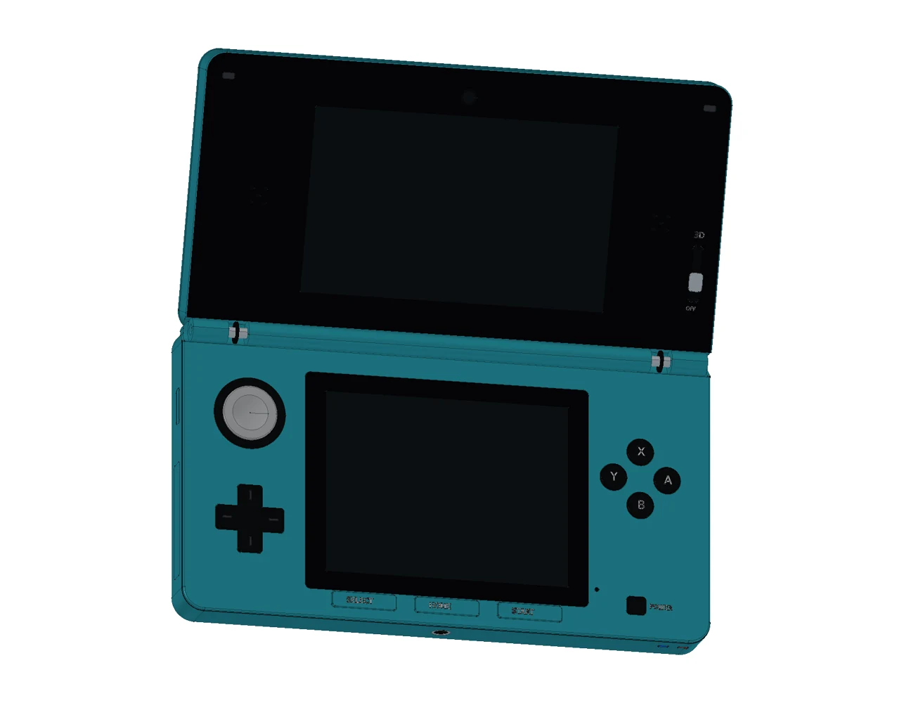

# Nintendo 3DS CTR-001

[在线展开预览](https://tiansongyu.github.io/open-console-cad/?device=3ds&view=assembled#viewer) · [闭合预览](https://tiansongyu.github.io/open-console-cad/?device=3ds&view=closed#viewer) · [分层爆炸](https://tiansongyu.github.io/open-console-cad/?device=3ds&view=exploded#viewer)

初代 CTR-001，采用 Aqua Blue 配色解释。完成 14 轮设计，324 个物理组件、388 个实体。包含双屏、可开合铰链、Circle Pad、十字键、ABXY、L/R、三摄像头、扬声器、接口、主要内部模块、伸缩触控笔和被动充电底座。

## 成品文件

- [完整展开模型](output/Nintendo3DS_Complete.FCStd)
- [闭合模型](output/Nintendo3DS_Closed.FCStd)
- [分层爆炸模型](output/Nintendo3DS_Exploded.FCStd)
- [FreeCAD 图纸](output/Nintendo3DS_Drawings.FCStd)
- [12 页 A3 PDF 图册](output/drawings/Nintendo3DS_Drawings.pdf)
- [整套 STEP](output/Nintendo3DS_FullKit.step) · [主机 STEP](output/Nintendo3DS_Handheld.step) · [闭合 STEP](output/Nintendo3DS_Closed.step) · [爆炸 STEP](output/Nintendo3DS_Exploded.step)
- [零件清单](output/COMPONENTS.csv) · [检查报告](output/reports/) · [迭代源码](scripts/) · [逐轮记录](ITERATIONS.md)

## 使用与重建

在 FreeCAD 1.1.3 中执行 `Open_Nintendo3DS.FCMacro` 打开主要文件。修改参数表 `Parameters.Opening` 后，执行 `Apply_Pose_Nintendo3DS.FCMacro` 应用开合角度，范围为 0–160°；0° 为闭合。铰链坐标保存在模型参数表和 StudyInfo 中，不依赖原来的会话。

`Rebuild_Nintendo3DS.FCMacro` 顺序重建 14 阶段，并将新文件写入 `output/rebuilt/`，保留交付文件。分轮入口在 `scripts/iterNN_*.py`，共享几何实现位于仓库 `tools/cadlib/`。必须保留完整仓库结构。

图纸是当前几何的快照，改模后需重新生成。网页 GLB 保留组件身份、颜色、爆炸位移和铰链参数；网页网格不能替代精确 CAD 实体。

## 尺寸与验证

闭合包络为 **134 × 74 × 21 mm**；上屏有效区 76.8 × 46.08 mm，下屏有效区 61.44 × 46.08 mm。其余局部尺寸、内部模块和底座尺寸为近似示意，依据见 [SOURCES.md](references/SOURCES.md)。

- 历史基线：324 个组件独立源码重建匹配，原生文件与四份 STEP 回读通过。
- 本轮展开状态 573 对、闭合状态 442 对候选组件，未发现超过 0.000001 mm³ 的穿插。
- 16 项直接模型尺寸及 17 项原生图纸尺寸参考核对通过。
- 历史基线：0°、80°、160° 的原生开合宏检查通过；本轮验证展开与闭合实体。
- 12 页图册通过 Kami 字体、内容、版式、密度与逐页视觉检查。

历史迭代中的问题可能已在后续轮次修复，使用最终文件和 [本轮交付检查](output/reports/exterior_delivery_checks.json)。原创代码遵循仓库 MIT；第三方权利说明见根目录。

## 2026-10-15 外观校准 · 第 14 轮

本轮更新 Circle Pad 凹面、灰色胶面和控制面板外缘。总体公开尺寸保持不变；局部数值属于官方图片或说明书拟合，依据与不确定性见 [校准依据](references/exterior_calibration.json)。没有原厂公差图或实机测量，不能证明完全一致或零件互换。

最新交付检查见 [本轮检查](output/reports/exterior_delivery_checks.json)：核对保存后的原生 BRep、装配干涉、公开包络、STEP 回读、图纸尺寸及网页源文件身份。本轮已检查该设备的全部网页视图、组件数量、下载链接、效果图及爆炸滑块，并检查公共查看器的桌面、平板和手机布局。全阶段源码重建与其余 22 款设备的网页交互未重跑；历史报告保留适用版本。本轮文件哈希与交付汇总于 2026-10-29 复核。
