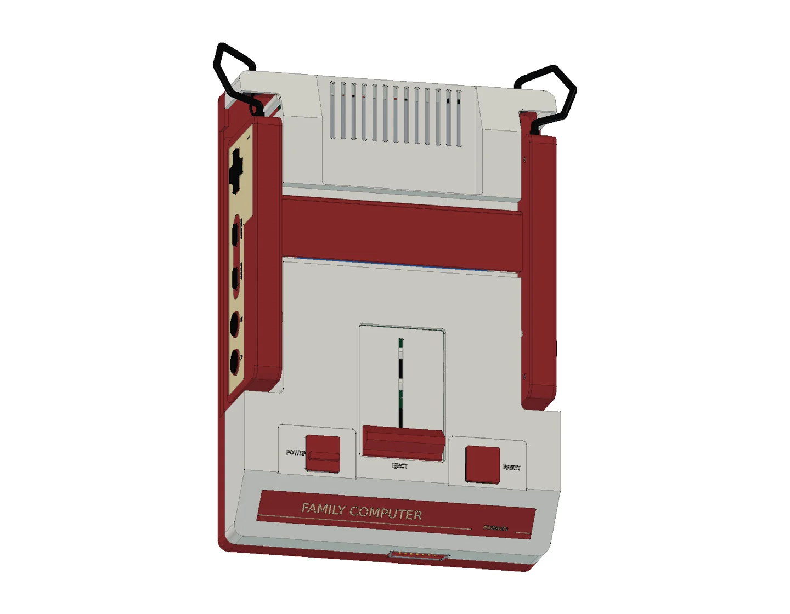

# Nintendo Famicom · HVC-001

本模型采用原版红白机的圆形按键版本，经过 **17 轮建模与修正，包含 638 个组件条目、1,457 个实体**。保留红白分壳、两侧手柄收纳槽、卡槽防尘盖、POWER/RESET 和退卡把手，以及原始 RF 输出和前部扩展口。

一号手柄包含 START/SELECT，二号手柄包含麦克风孔阵和音量滑块。内部提供独立手柄 PCB、导电胶垫、按键柱、主逻辑板、电源/RF 小板、60 接点卡座、滑动退卡机构、回位弹簧和线束。附件包括空白 FC 卡带、10 V 电源适配器、RF 转接盒与天线转换器。

## 交付状态

第 17 轮更新了卡带接点间距、扩展口位置与外观、后部散热槽、POWER/RESET 凹面及 DC/RF 配合接口，并修复旧扫掠和布尔结果的严格几何问题。当前 CAD、STEP、12 页图纸与网页模型同步更新，验证范围见 [本轮交付检查](output/reports/fidelity_delivery_checks.json)。旧线上报告保留为历史记录，不能代替本轮文件验证。

[在线 3D 预览](https://tiansongyu.github.io/open-console-cad/?device=famicom&view=assembled#viewer) · [内部结构](https://tiansongyu.github.io/open-console-cad/?device=famicom&view=internal#viewer) · [二号手柄](https://tiansongyu.github.io/open-console-cad/?device=famicom&view=controller2#viewer)

## 文件与使用方法

- [完整 FreeCAD 模型](output/Famicom_Complete.FCStd) · [爆炸装配](output/Famicom_Exploded.FCStd)
- [原生 FreeCAD 图纸](output/Famicom_Drawings.FCStd) · [12 页 A3 图册](output/drawings/Famicom_Drawings.pdf) · [SVG 与 HTML 图纸源文件](output/drawings/)
- [整套 STEP](output/Famicom_FullKit.step) · [主机 STEP](output/Famicom_Console.step) · [爆炸 STEP](output/Famicom_Exploded.step)
- [组件清单](output/COMPONENTS.csv) · [逐轮记录](ITERATIONS.md) · [检查报告](output/reports/)

完整工程包括 513 个主机与手柄组件，以及 125 个卡带和供电/RF 附件组件。卡带使用通用学习标签，不包含游戏 ROM 或游戏封面。附件线缆以片段和收纳状态展示，长度不代表原装线缆规格。

使用 FreeCAD 1.1.3 打开完整模型，或运行 `Open_Famicom.FCMacro` 同时打开整机、爆炸装配和原生图纸。模型保留机壳草图、尺寸约束、凸台、圆角、布尔加工历史，以及组件编号和装配分组。

运行 `Rebuild_Famicom.FCMacro` 会执行全部 17 轮源码，结果写入 `output/rebuilt/`，保留正式文件。入口位于 `scripts/iterNN_*.py`，主要实现为 `../../tools/cadlib/famicom.py`；请保留完整仓库结构。

`Parameters` 按 X 宽、Y 深、Z 高显示尺寸。`Depth (Y)` 和 `Height (Z)` 分别保留 `Height`、`ClosedDepth` 表达式别名，供现有建模工具使用。部分外壳草图通过表达式引用主尺寸，接口、孔位和内部模块仍使用明确的局部坐标；修改尺寸后需要重新检查装配。

图纸由 `scripts/drawing_geometry.py` 投影真实 BRep，并生成实体剖面，再运行 `python3 tools/cadlib/build_book.py devices/famicom` 通过 Kami 管线排版。原生图页包含自包含 SVG 和可测量尺寸参考；修改模型后需要重新生成。

## 尺寸与版本依据

| 项目 | 参数 | 依据 |
| --- | --- | --- |
| 主机包络 | 宽 150 × 深 220 × 高 60 mm | 任天堂原始说明书；外接线缆和独立附件另计 |
| 手柄外壳 | 约 126 × 52 mm | 本模型局部学习尺寸 |
| 主逻辑板 | 约 104 × 137 mm | 本模型布局尺寸 |
| 电源 | 适配器 DC 10 V / 850 mA；主机约 4 W | 任天堂公开规格 |
| 卡带 | 60 接点，节距 2.54 mm、PCB 引脚排距 5.08 mm；外壳约 108 × 72 mm | 节距参考兼容硬件开发资料；外壳和弹片形状为近似值 |
| 版本 | HVC-001，圆形按键手柄 | 不采用首批方形按键、AV Famicom 或 Mini 外观 |

来源见 [SOURCES.md](references/SOURCES.md) 和 [第 17 轮证据](references/fidelity_iteration17.json)。外观布局、色彩及局部形状参考 Nintendo 官方照片；这些照片未经颜色标定，不能确定工厂模具尺寸。扩展口采用兼容 DA-15 的名义接点格距，原装定制壳体深度、针径与配合公差仍待实测。主板采用拆机中的 HVC-CPU-GPM-02 修订版布局，不代表所有生产批次。曲面、壁厚、封装、线束、孔位与配合间隙为近似学习几何，不定义制造公差、电路连接、材料性能或热性能。

## 验证与维护

第 17 轮在保存的第 16 轮历史上执行；本轮未从空文档重跑全部源码。当前 638 个组件通过严格 BRep 检查，1,559 对候选组件求交无超过 0.000001 mm³ 的干涉；3 份 STEP 逐实体回读通过。24 项实机校准特征、28 项模型测量、13 个原生尺寸与 12 页 PDF 已核对，九种网页视图按当前导出文件检查。报告均绑定源文件哈希。

源码重建按组件核对实体有效性、实体数、包围盒和体积。STEP 按实体逐一匹配；曲面体积积分产生差异时，使用双向布尔差集核验几何。装配求交检查可分批执行，续查前必须匹配原生文件 SHA-256；只有 `complete` 与 `passed` 均为 `true` 才表示整套检查完成。

网页网格采用 0.10 mm 线性偏差、0.15 rad 角度偏差，保留全部组件、颜色、法线和爆炸位移。较大的模型另提供 gzip 传输文件，解压后与原始 GLB 逐字节一致；下载的原始 GLB 可供其他软件使用。修改网页模型后，运行 `python3 tools/compress_web_models.py famicom` 并同步目录中的压缩元数据。

原创内容采用根目录 MIT 协议；第三方名称、设计、字体与参考材料保留其原有权利，见 [第三方声明](../../THIRD_PARTY_NOTICES.md)。
