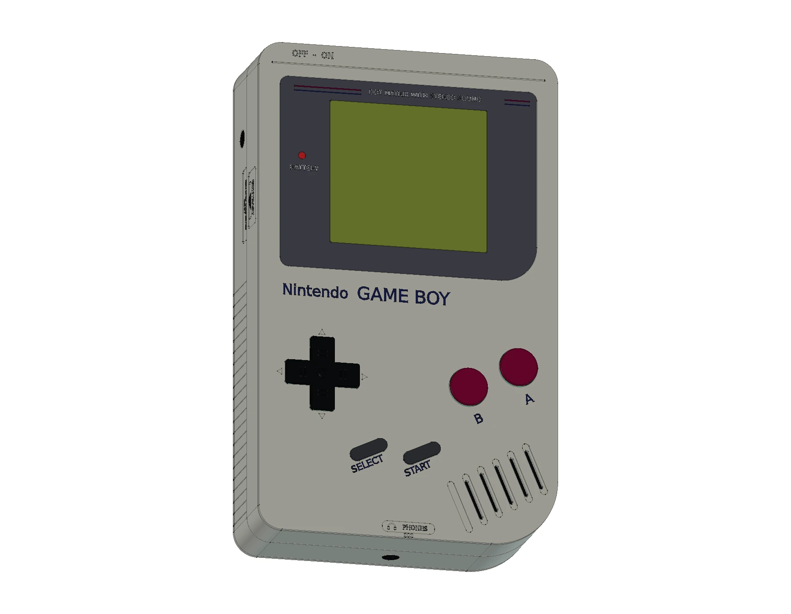

# Nintendo Game Boy · DMG-01

[整机 3D](https://tiansongyu.github.io/open-console-cad/?device=gameboy&view=assembled#viewer) · [内部结构](https://tiansongyu.github.io/open-console-cad/?device=gameboy&view=internal#viewer) · [四节 AA 电池](https://tiansongyu.github.io/open-console-cad/?device=gameboy&view=battery#viewer) · [空白卡带](https://tiansongyu.github.io/open-console-cad/?device=gameboy&view=accessories#viewer) · [分层爆炸](https://tiansongyu.github.io/open-console-cad/?device=gameboy&view=exploded#viewer)

本模型采用 1989 年初代灰色 DMG-01 外观，经过 **16 轮建模与修正，包含 417 个组件条目、842 个实体**。保留单色屏幕、十字键、酒红色 A/B 键、倾斜 START/SELECT 键、六条凹槽、五个通孔的扬声器格栅、音量与对比度滚轮、背部卡带槽和可拆电池盖。

内部包含四节 AA 电池、弹簧与片状触点、前后电路板、电源与耳机小板、CPU/RAM 封装、按键胶垫、LCD 固定框、扬声器及焊接互连。独立空白 Game Pak 卡带包含分壳、PCB、32 接点和 ROM 封装示意。

## 下载与查看

- [完整 FreeCAD 模型](output/GameBoy_Complete.FCStd) · [爆炸装配](output/GameBoy_Exploded.FCStd)
- [FreeCAD 原生图纸](output/GameBoy_Drawings.FCStd) · [12 页 A3 PDF 图册](output/drawings/GameBoy_Drawings.pdf) · [SVG 图页](output/drawings/)
- [整套 STEP](output/GameBoy_FullKit.step) · [主机 STEP](output/GameBoy_Handheld.step) · [爆炸 STEP](output/GameBoy_Exploded.step)
- [零件清单](output/COMPONENTS.csv) · [逐轮记录](ITERATIONS.md) · [检查报告](output/reports/)

整套文件包含 373 个主机组件、43 个卡带组件和 1 个拆下展示的通信口盖。网页提供整机、背面、内部结构、显示层、按键机构、主板、电池和卡带等视图；拖动“展开程度”可查看各装配层。卡带采用通用学习标识，不包含游戏 ROM 或游戏封面。

## 在 FreeCAD 中修改和重建

使用 FreeCAD 1.1.3 运行 `Open_GameBoy.FCMacro`，同时打开完整模型、爆炸装配和原生图纸，也可单独打开需要的文件。工程保留外壳草图、尺寸约束、凸台、大小角圆角和布尔加工历史；每个物理组件保存编号、分组与材质角色。

`Parameters` 保存宽、高、完整厚度与机壳基准；部分草图通过表达式引用宽高。接口、孔位、内部零件仍使用显式坐标，修改主参数后应重新检查装配。30.8 mm 是本模型的机壳基准，**32 mm 是包含控制件的完整整机厚度**。

运行 `Rebuild_GameBoy.FCMacro` 会依次执行全部 16 轮源码，输出至 `output/rebuilt/`，保留正式交付文件。入口位于 `scripts/iterNN_*.py`，主要实现为 `../../tools/cadlib/gameboy.py`；重建时请保留仓库结构。

`scripts/drawing_geometry.py` 从实际 BRep 生成投影与平面剖面，再运行 `python3 tools/cadlib/build_book.py devices/gameboy`，通过 Kami 管线生成图册。原生图纸包含自包含 SVG 图页与可测量的原生尺寸参考；修改模型后需要重新生成图纸。

网页网格使用 0.10 mm 线性偏差、0.15 rad 角度偏差，保留组件标识、颜色和爆炸偏移。GLB 用于交互预览，继续设计请使用 FCStd 或 STEP。

## 尺寸与版本依据

| 项目 | 参数 | 依据 |
| --- | --- | --- |
| 完整整机包络 | 90 × 148 × 32 mm | 任天堂公开宽、高、厚度 |
| 标称屏幕尺寸 | 47 × 43 mm | 任天堂直接公布的边长；像素有效区边界未独立确认 |
| 原机分辨率 | 160 × 144 像素 | 公开规格；CAD 不模拟图像显示 |
| 供电形式 | 四节 AA 电池 | 原始 DMG-01 结构 |
| 独立卡带外形 | 约 57 × 65 mm | 本模型学习尺寸 |
| 版本 | 初代灰色 DMG-01 | 单色非背光屏幕，圆形 A/B 按键 |

来源见 [SOURCES.md](references/SOURCES.md)。内部布局参考拆机中的具体主板修订版，不代表所有生产批次；没有采用 Game Boy Pocket、Color、IPS 背光改装或充电电池改装。局部轮廓、壁厚、封装、孔位、接点、线缆和配合间隙为近似学习几何，不定义电路或制造公差。

## 2026-11-08 · 实机外观复核

第 16 轮对照原机正面、背面及四侧照片，修正原先处于同一纵向位置的 DC 电源孔与对比度轮。音量轮恢复较厚轮缘，通信口改为下角倒角的原始大接口，六个接点分成两排；补上拆下展示的原装式接口盖。

正面格栅区分六条模压凹槽和五个较短通孔，最低一槽保留封闭底面。新增十字键周围的壳体箭头、PHONES 图文、底缘三条短筋及侧面模压文字；背面移除 CADSTUDY 字样，恢复常见型号和电源铭文。空白卡带改用六瓣外齿安全螺钉示意。局部坐标、槽深、倒角、字体和配合间隙仍为照片拟合，依据及未解决项见[本轮记录](references/fidelity_iteration16.json)。

47 × 43 mm 来自任天堂直接公布的屏幕边长，没有通过营销对角线换算。暂未找到与原机 LCD 型号明确对应的有效显示区机械图，因此保留标称窗口，不能将其表述为经实测的像素有效区。地区铭文、细小符号及内部零件仍不构成完整原厂复制。

## 验证记录

[本轮交付索引](output/reports/fidelity_delivery_checks.json)记录原生文件、STEP、网页网格与图纸的哈希。当前保存模型的 417 个组件通过严格 BRep 检查，35 项本轮几何检查核对侧别、端口位置、通信接点排列及格栅通孔。三个重叠文字经并集合并，双向材料差为零；四根电池弹簧按原参数分段扫掠，旧 C0 曲面的精确等价性不作承诺。

第 1–15 轮从源码重建后，以第 15 轮检查点复跑最新第 16 轮；最终 417 个组件与交付候选逐件比较。644 对相邻组件的实体求交、三份 STEP 回读、26 项直接尺寸及 14 项原生尺寸结果分别记录在报告中。12 页 A3 图册使用当前 BRep 的外观、剖面与爆炸投影，文件转换和数值检查阈值不代表实机制造精度。

旧版交付报告保留为历史记录；当前文件的检查以本轮交付索引中的哈希为准。

原创内容采用根目录 MIT 协议；第三方名称、设计、字体与参考材料见 [第三方声明](../../THIRD_PARTY_NOTICES.md)。
