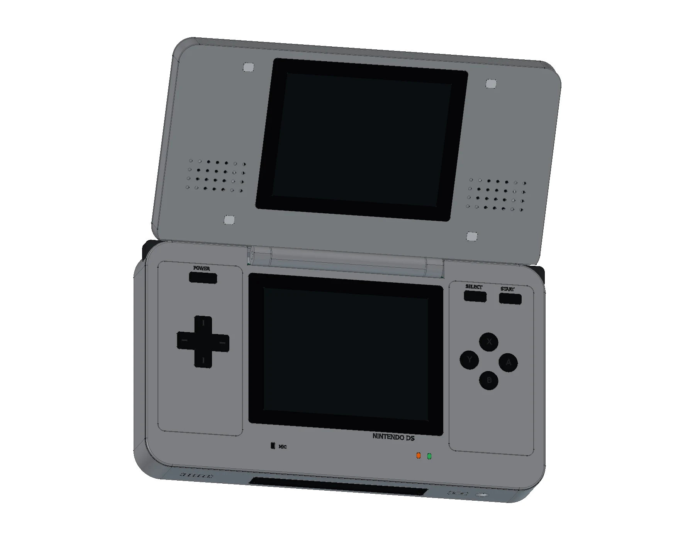

# Nintendo DS NTR-001

[在线展开预览](https://tiansongyu.github.io/open-console-cad/?device=nds&view=assembled#viewer) · [闭合预览](https://tiansongyu.github.io/open-console-cad/?device=nds&view=closed#viewer) · [分层爆炸](https://tiansongyu.github.io/open-console-cad/?device=nds&view=exploded#viewer)

初代 NTR-001 银色厚机身，完成 17 轮设计、321 个物理组件和 424 个实体。包括两块同尺寸显示屏、中央铰链、十字键、ABXY、系统键、L/R、双扬声器、DS Slot-1 与 GBA Slot-2、电池仓、主板、射频子板、排线和固定长度触控笔。版本为最早的 Nintendo DS。

## 成品文件

- [完整展开模型](output/NintendoDS_Complete.FCStd)
- [闭合模型](output/NintendoDS_Closed.FCStd)
- [分层爆炸模型](output/NintendoDS_Exploded.FCStd)
- [FreeCAD 图纸](output/NintendoDS_Drawings.FCStd)
- [12 页 A3 PDF 图册](output/drawings/NintendoDS_Drawings.pdf)
- [整套 STEP](output/NintendoDS_FullKit.step) · [主机 STEP](output/NintendoDS_Handheld.step) · [闭合 STEP](output/NintendoDS_Closed.step) · [爆炸 STEP](output/NintendoDS_Exploded.step)
- [零件清单](output/COMPONENTS.csv) · [检查报告](output/reports/) · [迭代源码](scripts/)

## 使用与重建

在 FreeCAD 1.1.3 中执行 `Open_NintendoDS.FCMacro` 打开主要文件。修改参数表 `Parameters.Opening` 后，执行 `Apply_Pose_NintendoDS.FCMacro` 应用开合角度，范围为 0–150°；0° 为闭合。铰链坐标保存在模型参数表和 StudyInfo 中，不依赖原来的会话。

`Rebuild_NintendoDS.FCMacro` 顺序重建 17 阶段，并将新文件写入 `output/rebuilt/`，保留交付文件。分轮入口在 `scripts/iterNN_*.py`，共享几何实现位于仓库 `tools/cadlib/`。必须保留完整仓库结构。

图纸是当前几何的快照，改模后需重新生成。网页 GLB 保留组件身份、颜色、爆炸位移和铰链参数；网页网格不能替代精确 CAD 实体。

## 尺寸与验证

闭合包络为 **148.7 × 84.7 × 28.9 mm**。两块屏幕均为 3 英寸、4:3；本模型将其换算为 60.96 × 45.72 mm 显示窗口。局部外形、孔位、壁厚、PCB 和封装等为近似研究模型，依据见 [SOURCES.md](references/SOURCES.md)。

- 历史基线：321 个组件独立源码重建匹配，原生文件与四份 STEP 回读通过。
- 本轮 0°、75°、150° 分别检查 491、573、599 对候选组件，均完成逐组件实体求交，未发现超过 0.000001 mm³ 的穿插，候选数量见最终报告。
- 19 项图纸尺寸及 19 项原生图纸尺寸参考核对通过。
- 历史基线：原生开合宏检查通过；本轮独立读取保存实体并验证 0°、75°、150° 三种姿态。
- 12 页图册通过 Kami 字体、内容、版式、密度与逐页视觉检查。

图册包含展开总装、闭合三视图、双屏尺寸、按键与双卡槽详图、真实 BRep 剖面、整机及上下机身爆炸图、主板与电池、触控笔与电池仓、材料索引和尺寸来源。

[逐轮迭代与效果图](ITERATIONS.md)。历史问题已在后续轮次修正；使用最终原生文件和 [本轮交付检查](output/reports/fidelity_delivery_checks.json)。原创代码遵循仓库 MIT，第三方权利说明见根目录。

## 2026-10-15 外观校准 · 第 16 轮

本轮更新下机身控制面板与上盖的厚度方向边缘过渡。总体公开尺寸保持不变；局部数值属于官方图片或说明书拟合，依据与不确定性见 [校准依据](references/exterior_calibration.json)。没有原厂公差图或实机测量，不能证明完全一致或零件互换。

最新交付检查见 [本轮检查](output/reports/exterior_delivery_checks.json)：核对保存后的原生 BRep、装配干涉、公开包络、STEP 回读、图纸尺寸及网页源文件身份。本轮已检查该设备的全部网页视图、组件数量、下载链接、效果图及爆炸滑块，并检查公共查看器的桌面、平板和手机布局。全阶段源码重建与其余 22 款设备的网页交互未重跑；历史报告保留适用版本。本轮文件哈希与交付汇总于 2026-10-29 复核。

## 2026-11-08 实机资料复核 · 第 17 轮

- 触控笔最大直径由 3.4 mm 修正为官方约 4.0 mm，保留约 75 mm 总长。
- 按原版说明书修正左侧橙色充电灯、右侧绿色电源灯。颜色表示正常开机且充电的展示状态。
- 七枚后盖固定螺钉由十字槽改为拆机资料所示的 Y 形槽。螺钉长度、头部尺寸和内部固定柱仍为近似值。
- 初始 profile 的屏幕中心参数与已有最终模型统一为下屏 Y=4、上屏 Y=84 mm；实际屏幕位置未改变。

本轮同步更新展开、闭合、爆炸 CAD、四份 STEP、组件清单、12 页图册和网页模型。保存实体、三种开合姿态、STEP 回读、19 项原生尺寸参考及 7 个网页视图已核验。全阶段源码重建和连续开合碰撞扫描未在本轮重跑，历史记录不能证明本轮执行过这些检查。

来源、改动及未确定尺寸见 [第 17 轮依据](references/fidelity_iteration17.json)，文件哈希与当前检查见 [本轮交付检查](output/reports/fidelity_delivery_checks.json)。本轮修正了已确认的差异，仍不代表内部结构或零件互换达到实机精度。
