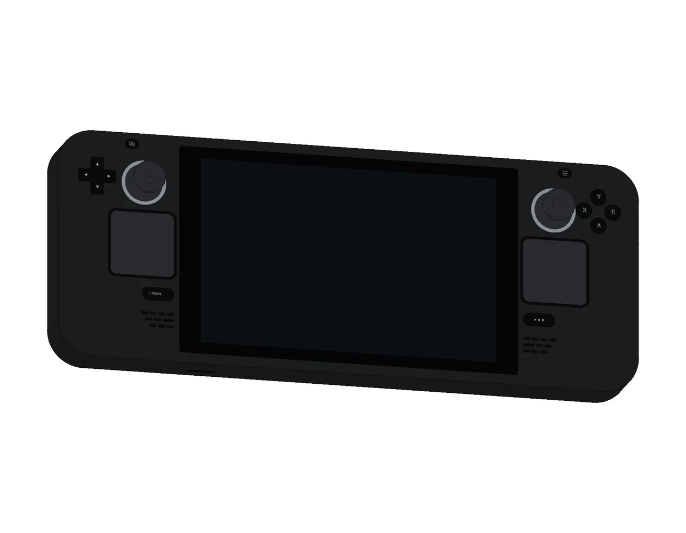

# Steam Deck · 2022 LCD

[整机 3D](https://tiansongyu.github.io/open-console-cad/?device=steamdeck&view=assembled#viewer) · [内部结构](https://tiansongyu.github.io/open-console-cad/?device=steamdeck&view=internal#viewer) · [触控板反馈](https://tiansongyu.github.io/open-console-cad/?device=steamdeck&view=touchpads#viewer) · [散热系统](https://tiansongyu.github.io/open-console-cad/?device=steamdeck&view=cooling#viewer) · [分层爆炸](https://tiansongyu.github.io/open-console-cad/?device=steamdeck&view=exploded#viewer)

本项目按 2022 年初代 LCD 型号制作，经过 17 轮建模与修正，包含 **500 个组件、577 个实体**。机身保留双方形触控板、双摇杆、四枚背键、肩键与扳机、曲面握把、黑色电源键和进出风格栅。内部包含独立输入板、触控板音圈与弹片、40 Wh L 形电池、APU 与内存封装、M.2 2230 存储、单风机、铜热管与早期银色主板罩。

## 下载与查看

- [完整 FreeCAD 模型](output/SteamDeck_Complete.FCStd) · [爆炸装配](output/SteamDeck_Exploded.FCStd)
- [FreeCAD 原生图纸](output/SteamDeck_Drawings.FCStd) · [12 页 A3 PDF 图册](output/drawings/SteamDeck_Drawings.pdf)
- [整套 STEP](output/SteamDeck_FullKit.step) · [主机 STEP](output/SteamDeck_Handheld.step) · [爆炸 STEP](output/SteamDeck_Exploded.step)
- [零件清单](output/COMPONENTS.csv) · [逐轮记录](ITERATIONS.md) · [检查报告](output/reports/)

整套文件包含 493 个主机组件和 7 个电源附件组件。45 W USB-C 电源为通用尺寸示意，不对应特定地区的插头规格。网页可单独观察双触控板的反馈层、操作机构、散热、电池、主板与存储；选择“分层爆炸”或拖动“展开程度”滑块查看内部关系。

## 在 FreeCAD 中修改和重建

使用 FreeCAD 1.1.3 运行 `Open_SteamDeck.FCMacro`，或直接打开完整模型。模型保留原生外壳草图、尺寸约束、凸台、圆角和布尔加工历史，各组件具有编号、装配分组和材质角色。

`Parameters` 保存宽、高、完整厚度与机壳基准。部分宽高表达式连接到原生草图；接口、孔位和内部模块使用显式坐标，修改主参数后应重新检查装配。37 mm 为近似的前壳建模基准，**公开的 49 mm 是包含控制件的完整整机厚度**。

运行 `Rebuild_SteamDeck.FCMacro` 会按顺序执行全部 17 轮源码，将模型、STEP 和预览保存到 `output/rebuilt/`，保留交付文件。入口位于 `scripts/iterNN_*.py`，主要实现为 `../../tools/cadlib/steamdeck.py`，应保留整个仓库目录结构。

图纸由 `scripts/drawing_geometry.py` 投影实际 BRep 并生成真实剖面，再通过 `python3 tools/cadlib/build_book.py devices/steamdeck` 使用 Kami 管线生成 PDF。原生图页含自包含 SVG 和可测尺寸参考；修改三维模型后需要重新生成图纸。PDF 的字体、内容和逐页检查结果保存在报告中。

网页 GLB 使用 0.10 mm 线性偏差、0.15 rad 角度偏差，保留组件编号、材质和爆炸偏移。网格用于预览，继续设计请使用 FCStd 或 STEP。

## 尺寸与版本依据

| 项目 | 参数 | 依据 |
| --- | --- | --- |
| 完整整机包络 | 298 × 117 × 49 mm | Valve 原始规格，包含控制件 |
| 显示窗口 | 151.7 × 95.2 mm | Valve 2022-02-02 参考图，第 2 页 |
| 盖板外形 | 173.7 × 106.7 mm | 同一 Valve 参考图 |
| 触控板表面 | 32.5 × 32.5 mm | 当前模型近似尺寸 |
| 电池 | 40 Wh / 5200 mAh | 公开规格；电芯形状为布局示意 |
| 存储模块 | M.2 2230 | PCB 近似模型为 22 × 30 mm |
| 型号 | 2022 LCD | 早期银色主板罩、黑色电源键 |

来源见 [SOURCES.md](references/SOURCES.md)。维修指南包含后续修订机型，本项目仅选取初代 LCD 的结构参考。局部曲面、壁厚、孔位、封装、接点、排线和安装间隙为近似学习几何，不包含真实电路、材料性能或制造公差，也不模拟触控反馈和散热性能。

## 2026-11-08 Valve 参考复核 · 第 17 轮

显示区和盖板外形改用 Valve 参考图的机械尺寸，替换原来的标称 7 英寸换算值。双麦克风移至 X=±62 mm、Y=53.819 mm，孔径按公开 CAD 特征测量修正为 0.764 mm；触控板和 Steam／快捷访问键的位置一并校准。每侧扬声器由 12 孔改为 10 孔，顶部排风由偏左的 13 孔改为居中的 11 孔，并补齐环境光传感器窗口。

Valve 图中的麦克风直径 2 mm、光传感器直径 3 mm 和排风 56.5 mm 标注是附件避让范围，不是实际孔径。光传感器窗口直径、局部圆角、内部安装层与散热布局仍为近似；内部麦克风封装为避开原有天线薄片上移 1.3 mm，该深度没有原厂尺寸依据。来源、镜像提交及文件哈希见 [本轮依据](references/fidelity_iteration17.json)。参考文件仅在本地检查，没有把 Valve 的实体、网格或图纸嵌入交付物。

本轮 500 个组件通过 820 对实体求交检查，未发现超过 0.000001 mm³ 的穿插；35 项参考特征检查、28 项直接尺寸和 15 个原生图纸尺寸参考通过核对。原生文件、三份 STEP 和 12 页图册已重新生成与检查，详情见 [本轮交付检查](output/reports/fidelity_delivery_checks.json)。本轮未重跑全部 17 阶段源码，也没有制造公差、零件互换或实机一致性认证。

## 验证记录

历史第 16 轮的 498 个组件通过全部 16 轮源码重建，817 对候选组件求交未发现实体穿插。原生整机、爆炸装配和三份 STEP 回读通过；第 16 轮将热管改为直接扫掠椭圆截面，修复了交换格式中的曲面接缝问题。曲面体积积分的数值差异使用双向布尔差集核验，不以总体积相近代替形状检查。

历史第 16 轮的 26 项直接模型尺寸、15 项原生图纸尺寸参考通过核对。12 页图册涵盖整机、接口、显示、双触控板、真实剖面、爆炸装配、主板、电池、散热和操作机构，并完成 Kami 字体、内容、排版及逐页视觉检查。

原创内容采用根目录 MIT 协议；第三方名称、设计、字体与参考材料见 [第三方声明](../../THIRD_PARTY_NOTICES.md)。
