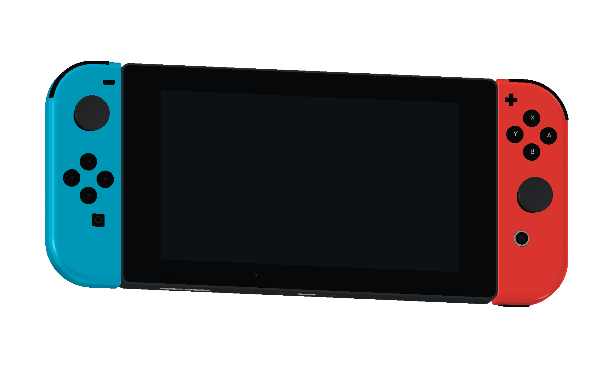

# Nintendo Switch · FreeCAD 项目

[在线整机预览](https://tiansongyu.github.io/open-console-cad/?device=switch&view=assembled#viewer) · [在线爆炸视图](https://tiansongyu.github.io/open-console-cad/?device=switch&view=exploded#viewer) · [仓库使用说明](../../README.md)

17 轮设计，654 个组件、835 个实体。包含主机、左右手柄、底座、非充电握把与两套腕带。整体包络参考官方数据，局部尺寸和内部结构为近似示意。

2026-10-13 外形精修针对初代 HAC-001：重新建立 Joy-Con 外轮廓及前后壳的厚度方向圆角，缩窄肩键并重塑扳机，校正摇杆、按键、扬声器和亮度传感器位置。对比同一视角的[原边缘](output/previews/edge_before.png)与[新边缘](output/previews/edge_after.png)，或查看[独立虚拟桌面截图](output/previews/virtual_desktop_final.png)。圆角和局部坐标依据官方照片拟合，未使用原厂 CAD 或实物扫描，不能视为制造级复刻。

第 17 轮将[公开资料外缘校准研究](studies/public-reference/README.md)中的不等宽过渡并入整机：前壳外侧约 3.5 mm、后壳外侧约 6.0 mm、导轨侧约 0.65 mm，直边增加约束截面以消除放样内凹，并将八个面键直径从 6.36 mm 调整为 7.6 mm。保留第 16 轮内腔与孔位；不采用试验中无效的拟合内腔。局部曲率与按键尺寸仍是公开图像估计。

## 打开文件

- [完整模型](output/Switch_Complete.FCStd)：保留草图、凸台、圆角、布尔操作与参数表。
- [爆炸装配](output/Switch_Exploded.FCStd)：独立组件与爆炸位移。
- [FreeCAD 图纸](output/Switch_Drawings.FCStd)：12 页自包含图页与原生尺寸参考。
- [A3 PDF 图册](output/drawings/Switch_Drawings.pdf)：总装、接口、剖面、爆炸和材料索引。
- [带色整套 STEP](output/Switch_FullKit.step) · [手持整机 STEP](output/Switch_Handheld.step) · [底座 STEP](output/Switch_Dock.step)。
- [组件清单](output/COMPONENTS.csv) · [效果图](output/previews/) · [检查报告](output/reports/)。

在 FreeCAD 中运行 `Open_Switch.FCMacro` 可打开主要成品；运行 `Rebuild_Switch.FCMacro` 会将各轮结果生成到 `output/rebuilt/`，保留当前交付。已验证 FreeCAD 1.1.3。

## 源码与维护

- [逐轮源码索引](ITERATIONS.md)。历史二进制检查点不提交，可运行重建宏生成。
- 保留 12 个历史原生圆角特征；第 17 轮的四组外缘由原生截线、放样、包络裁剪和左右镜像生成，并沿用内腔布尔历史。第 17 轮参数表记录拟合值，不实时驱动截线；改变曲率需重建校准样件并重新执行第 17 轮。历史圆角参数不再直接控制当前四片壳体的外缘。
- 图纸为当前模型快照，修改模型后需要重新生成。涉及校准外壳的线图由可见 BRep 投影边线按 0.01 mm 弦偏差输出，避免 SVG 样条转换产生的错误延长线；不改变三维曲面或尺寸端点。
- 网页网格由实际 FCStd 导出，详细维护方法见 [维护指南](../../docs/MAINTAINING.md)。
- 公开尺寸、局部近似和参考链接见 [SOURCES.md](references/SOURCES.md)。

## 许可

原创内容按仓库 [MIT](../../LICENSE) 授权；第三方名称、标识、字体与参考资料见 [第三方声明](../../THIRD_PARTY_NOTICES.md)。

本版检查见[外形与原生特征](output/reports/exterior_refinement_audit.json)、[装配干涉](output/reports/17_interference_audit.json)、[导出回读](output/reports/export_roundtrip_audit.json)及[图纸尺寸](output/reports/drawing_checks.json)。尺寸由已保存的原生 BRep 使用 `optimalBoundingBox(False, False)` 重新测量；手持整机与 239 × 102 mm 的名义包络相符（这是 CAD 数值检查，不是实机公差），主机厚 13.9 mm，含摇杆和扳机的最大厚度为 28.4 mm。

本轮从第 14 轮成品执行第 15–17 轮并重新导出。回读检查使用 `audit_exports.py output --saved-geometry --surface-fallback=JoyLFront,JoyLRear,JoyRFront,JoyRRear --surface-distance-mm=0.001` 比较已保存 BRep，不代表全历史重算或参数编辑测试。四片校准外壳包含大量相切与重合曲面，因此这些零件使用双向表面采样距离确认，文件转换的检查阈值明确设为 0.001 mm，并在报告中保留实测偏差与内核容差。该阈值不表示实机精度，采样不等同于解析几何恒等证明。旧的 `14_interference_audit.json`、`16_interference_audit.json`、`completion_audit.json`、`rebuild_verification.json`、`parameter_edit_test.json`、`open_macro_test.json` 等报告及 `Switch_Cutaway.FCStd` 保留为历史资料，不代表本版验证。
