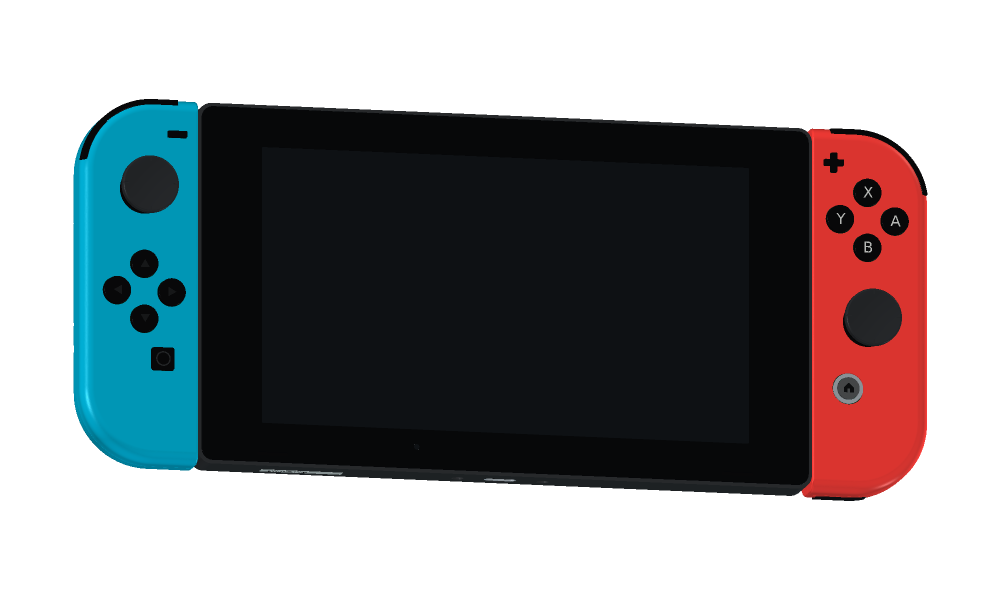

# Nintendo Switch · FreeCAD 项目

[在线整机预览](https://tiansongyu.github.io/open-console-cad/?device=switch&view=assembled#viewer) · [在线爆炸视图](https://tiansongyu.github.io/open-console-cad/?device=switch&view=exploded#viewer) · [仓库使用说明](../../README.md)

18 轮设计，654 个组件、835 个实体。包含主机、左右手柄、底座、非充电握把与两套腕带。整体包络参考官方数据，局部尺寸和内部结构为近似示意。

2026-10-29 第 18 轮根据 Nintendo 官方图像复核 HAC-015/HAC-016 Joy-Con 的 26 个操作件。HOME 改为灰色芯与黑色房屋图形，芯直径 6.1 mm、外环外径 8.4 mm；截图键边长 6.3 mm，内部图案外径 4.1 mm。两键中心分别为 X=96.6 / -96.6 mm、Y=-22 mm。ABXY 字形按实际边界居中，字高 3.05 mm；方向三角为 2.6 × 2.2 mm。

导轨侧 SL/SR 帽体为 3.6 × 8.2 mm，上、下中心 Y=23.5 / -18 mm；右手柄修正为上 SR、下 SL。SYNC 直径 3.1 mm、中心 Y=-6 mm；四颗玩家灯中心 Y=12、8、4、0 mm，与侧键同处 Z=7.4 mm。圆形面键直径 7.6 mm、中心至组中心距离 7.7 mm，以及摇杆帽直径 15.8 mm 保留；加减键、肩键、扳机和释放键沿用现有尺寸。数值与像素依据见[按键校准记录](references/control_calibration.json)和[来源说明](references/SOURCES.md#2026-10-29-按键比例与位置校准)。局部图像估计误差约 0.3–0.5 mm，另有缩放基准歧义；这些数值不是原厂公差，也不是经实机测量验证的误差上限。

2026-10-13 外形精修针对初代 HAC-001：重新建立 Joy-Con 外轮廓及前后壳的厚度方向圆角，缩窄肩键并重塑扳机，校正摇杆、按键、扬声器和亮度传感器位置。对比同一视角的[原边缘](output/previews/edge_before.png)与[新边缘](output/previews/edge_after.png)，或查看[独立虚拟桌面截图](output/previews/virtual_desktop_final.png)。圆角和局部坐标依据官方照片拟合，未使用原厂 CAD 或实物扫描，不能视为制造级复刻。

第 17 轮将[公开资料外缘校准研究](studies/public-reference/README.md)中的不等宽过渡并入整机：前壳外侧约 3.5 mm、后壳外侧约 6.0 mm、导轨侧约 0.65 mm，直边增加约束截面以消除放样内凹，并将八个面键直径从 6.36 mm 调整为 7.6 mm。保留第 16 轮内腔与孔位；不采用试验中无效的拟合内腔。局部曲率与按键尺寸仍是公开图像估计。

[左手柄按键](output/previews/18_control_proportions_left_controls.png) · [右手柄按键](output/previews/18_control_proportions_right_controls.png) · [左侧键](output/previews/18_control_proportions_left_rail.png) · [右侧键](output/previews/18_control_proportions_right_rail.png) · [本轮虚拟桌面](output/previews/controls_virtual_desktop.png)

## 打开文件

- [完整模型](output/Switch_Complete.FCStd)：保留草图、凸台、圆角、布尔操作与参数表。
- [爆炸装配](output/Switch_Exploded.FCStd)：独立组件与爆炸位移。
- [FreeCAD 图纸](output/Switch_Drawings.FCStd)：12 页自包含图页与原生尺寸参考。
- [A3 PDF 图册](output/drawings/Switch_Drawings.pdf)：总装、接口、剖面、爆炸和材料索引。
- [带色整套 STEP](output/Switch_FullKit.step) · [手持整机 STEP](output/Switch_Handheld.step) · [底座 STEP](output/Switch_Dock.step)。
- [组件清单](output/COMPONENTS.csv) · [效果图](output/previews/) · [检查报告](output/reports/)。

在 FreeCAD 中运行 `Open_Switch.FCMacro` 可打开主要成品；运行 `Rebuild_Switch.FCMacro` 会将各轮结果生成到 `output/rebuilt/`，保留当前交付。已验证 FreeCAD 1.1.3。

## 源码与维护

- [逐轮源码索引](ITERATIONS.md)。历史二进制检查点不提交，可运行重建宏生成。
- 保留 12 个历史原生圆角特征；第 17 轮的四组外缘由原生截线、放样、包络裁剪和左右镜像生成，并沿用内腔布尔历史。第 17 轮参数表记录拟合值，不实时驱动截线；改变曲率需重建校准样件并重新执行第 17 轮。历史圆角参数不再直接控制当前四片壳体的外缘。
- 第 18 轮参数表记录按键拟合目标，修改表格不会自动更新按钮；调整尺寸需修改第 18 轮源码并重建。
- 图纸为当前模型快照，修改模型后需要重新生成。涉及校准外壳的线图由可见 BRep 投影边线按 0.01 mm 弦偏差输出，避免 SVG 样条转换产生的错误延长线；不改变三维曲面或尺寸端点。
- 网页网格由实际 FCStd 导出，详细维护方法见 [维护指南](../../docs/MAINTAINING.md)。
- 公开尺寸、局部近似和参考链接见 [SOURCES.md](references/SOURCES.md)。

## 许可

原创内容按仓库 [MIT](../../LICENSE) 授权；第三方名称、标识、字体与参考资料见 [第三方声明](../../THIRD_PARTY_NOTICES.md)。

本版验证范围与结果见[交付检查索引](output/reports/control_delivery_checks.json)、[按键与位置](output/reports/control_calibration_audit.json)、[装配干涉](output/reports/control_interference.json)、[外形与原生特征](output/reports/exterior_refinement_audit.json)、[导出回读](output/reports/export_roundtrip_audit.json)及[图纸尺寸](output/reports/drawing_checks.json)。尺寸由已保存的原生 BRep 使用 `optimalBoundingBox(False, False)` 测量；手持整机与 239 × 102 mm 的名义包络相符（这是 CAD 数值检查，不是实机公差），主机厚 13.9 mm，含摇杆和扳机的最大厚度为 28.4 mm。

第 18 轮从第 17 轮已保存成品更新按键，本轮未重跑全部 18 轮源码或参数编辑测试。第 17 轮此前从第 14 轮成品执行第 15–17 轮。导出回读以已保存 BRep 为依据；四片校准外壳包含大量相切与重合曲面，使用 `audit_exports.py output --saved-geometry --surface-fallback=JoyLFront,JoyLRear,JoyRFront,JoyRRear --surface-distance-mm=0.001` 进行双向表面采样检查。0.001 mm 是文件转换检查阈值，不表示实机精度，采样不等同于解析几何恒等证明。旧的 `14_interference_audit.json`、`16_interference_audit.json`、`17_interference_audit.json`、`completion_audit.json`、`rebuild_verification.json`、`parameter_edit_test.json`、`open_macro_test.json` 等报告及 `Switch_Cutaway.FCStd` 保留为历史资料，不代表本版验证。
