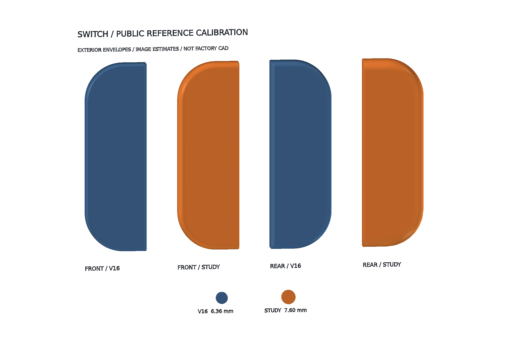
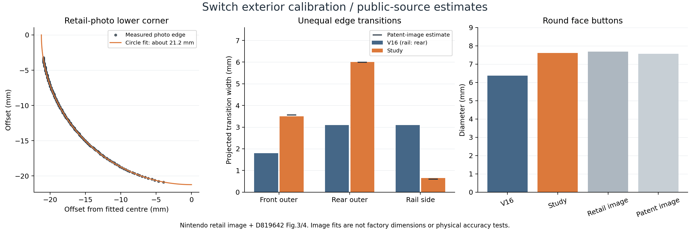

# Switch 公开资料外缘校准

2026-10-13。这里保留 V16 与候选外缘的独立对照研究。**第 17 轮已采用这组外缘，配合保留的 V16 内腔与孔位完成整机集成**；本目录的样件仍单独展示外包络。在独立虚拟桌面的 FreeCAD 中生成了前后外壳的实心外包络和面键直径对照，用来检验外缘改法。样件没有内腔、装配配合或制造公差。

[](Switch_Public_Reference_Study.FCStd)

## 已找到的差异

Nintendo 的 [D819642 外观专利](https://patentimages.storage.googleapis.com/57/37/2a/8dd4c3079855b2/USD819642S1.pdf) 第 3、4 图显示，外侧与贴导轨侧的过渡宽度明显不同。V16 的厚度方向圆角沿整圈采用相同半径，导致外侧不够圆润、导轨侧却过度圆滑。专利的产品归属可由 [Nintendo 专利标记页](https://www.nintendo.com/us/patents/)核对。

以 [Nintendo Joy-Con 公开高度 102 mm](https://www.nintendo.com/my/hardware/switch/modal/specs/joy-con.html)作比例锚点，得到以下**图像估计**。边缘数值是投影中的过渡宽度，只有在选用圆弧截面时才作为建模半径使用；它们不是原厂标注尺寸。

| 检查项 | V16 | 公开图估计 | 样件采用 |
|---|---:|---:|---:|
| 前壳外侧过渡 | 1.8 mm | 约 3.6 mm | 3.5 mm |
| 后壳外侧过渡 | 3.1 mm | 约 6.0 mm | 6.0 mm |
| 后壳导轨侧过渡 | 3.1 mm | 约 0.6 mm | 0.65 mm |
| 圆形面键直径 | 6.36 mm | 官方图片约 7.7 mm；专利图约 7.5 mm | 7.6 mm |
| 平面外侧圆角 | 20.5 mm | 官方图片局部拟合约 21.2 mm | 暂保留 20.5 mm |

最后一项没有直接改成 21.2 mm：图片缩放和轮廓选取会影响结果，单张营销图不足以证明应更改全局轮廓。[Nintendo 零部件视图](https://www.nintendo.com/sg/hardware/detail/switch/index.html)提供前、后、侧面的交叉参考。形状、肩键凸出量、壳体高度和厚度需要作为同一组约束继续核对，不能把所有外轮廓都强行贴到 102 mm 的壳体上。

[](reference-measurements.json)

## 文件与检查

- [原生 FreeCAD 样件](Switch_Public_Reference_Study.FCStd)：48 条截线、两个可编辑放样、两个 V16 外包络及两个按钮试样。运行 [打开宏](Open_Public_Reference_Study.FCMacro)查看。
- [外包络 STEP](Switch_Exterior_Envelopes.step)：仅四个壳体外包络，方便其他 CAD 软件比较；不含面键试样。
- [正投影对照](front-comparison.png)、[虚拟桌面截图](virtual-desktop.png)。
- [公开图测量记录](reference-measurements.json)、[曲面检查](study-checks.json)、[独立回读检查](export-checks.json)。

两个候选曲面均为有效单实体。补充直边约束截线，消除仅用两个直边截面导致的局部内凹。对所选完整直边与圆弧截面的采样偏差分别约 0.004 mm 和 0.006 mm（检查阈值 0.02 mm）；放样后用原生布尔交约束平面尺寸，重新测得包络与 33 × 102 mm 的差异小于 0.001 mm，已在记录中列出实际值。这些是模型内部的数值检查，不是对实机的精度。独立重开 FCStd 和 STEP，检查实体有效性、包络和体积；未做全历史重算或解析曲面恒等证明。

[左手柄接合试验](assembly-trial.json)未通过：试制左前壳的拟合内腔本身 BRep 无效，后续布尔结果也无效；左后壳为有效实体，但与三颗螺钉及三个螺钉柱产生重叠。无效前壳未进行干涉检测，因此其空干涉列表不表示通过。试验使用拟合内腔，不能代表原厂内腔；右手柄尚未试验。这个试验方案已被放弃；第 17 轮采用保留 V16 内腔的方案，整机检查见下文。失败试制件不包含在交付的原生样件或 STEP 中。可运行 [trial_assembly_fit.py](trial_assembly_fit.py)复现各阶段诊断。

## 复现

在 FreeCAD GUI Python 控制台执行 `build_study.py`，脚本读取整机文件中保留的 V16 历史外包络，并在新文档中生成样件；已有同名样件文档需先关闭。参数表记录采用值，修改研究输入需编辑源码并重新生成，参数表不是实时驱动器。

```python
from pathlib import Path
p = Path('/path/to/repo/devices/switch/studies/public-reference/build_study.py')
exec(compile(p.read_bytes(), str(p), 'exec'), {'__file__': str(p)})
```

测量脚本需要 NumPy、SciPy、OpenCV 和 Matplotlib。指定仓库外或被忽略的参考缓存目录，脚本只下载缺失的两份公开资料，并核对记录的 SHA-256；原图与专利全文不随本研究发布。

```bash
python3 devices/switch/studies/public-reference/measure_references.py .local/switch-reference-cache
```

`audit_study.py` 在可导入 FreeCAD、Part、Sketcher、Spreadsheet 的 Python 环境运行，重新生成导出检查报告。

## 距离原厂一致性还缺什么

公开图片与外观专利足以纠正可见比例和曲面走势，但没有完整曲率、壁厚、定位基准、模具补偿和制造公差。专利图也不保证每处细节等同于量产模具。因此目前只能称为“依据公开资料校准的外观研究”，不能证明与实物完全一致或零件可以互换。

第 17 轮保留 V16 内腔与孔位，采用这组外缘并扩大面键，已将整机 FCStd、STEP、图纸与网页网格同步更新。完整装配检查见[第 17 轮报告](../../output/reports/17_interference_audit.json)，外形尺寸与外缘建模历史见[外形检查](../../output/reports/exterior_refinement_audit.json)。这种保留示意内腔的做法改善外观一致性，并不能证明原厂壁厚、模具曲率或机械互换性。
