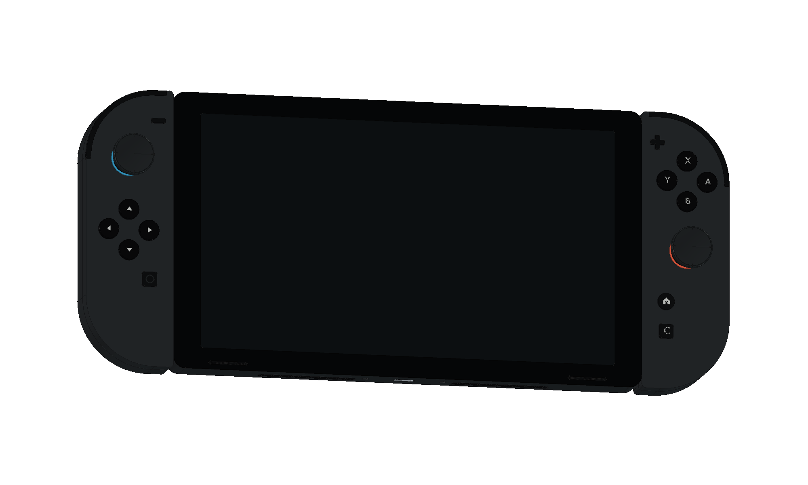

# Nintendo Switch 2 · FreeCAD 项目

[在线整机预览](https://tiansongyu.github.io/open-console-cad/?device=switch2&view=assembled#viewer) · [在线爆炸视图](https://tiansongyu.github.io/open-console-cad/?device=switch2&view=exploded#viewer) · [仓库使用说明](../../README.md)

17 轮设计，807 个组件、971 个实体。包含主机、左右手柄、底座、非充电握把与两套腕带。整体包络参考官方数据，局部尺寸和内部结构为近似示意。

## 打开文件

- [完整模型](output/Switch2_Complete.FCStd)：保留草图、凸台、圆角、布尔操作与参数表。
- [爆炸装配](output/Switch2_Exploded.FCStd)：独立组件与爆炸位移。
- [FreeCAD 图纸](output/Switch2_Drawings.FCStd)：12 页自包含图页与原生尺寸参考。
- [A3 PDF 图册](output/drawings/Switch2_Drawings.pdf)：总装、接口、剖面、爆炸和材料索引。
- [带色整套 STEP](output/Switch2_FullKit.step) · [手持整机 STEP](output/Switch2_Handheld.step) · [底座 STEP](output/Switch2_Dock.step)。
- [组件清单](output/COMPONENTS.csv) · [效果图](output/previews/) · [检查报告](output/reports/)。

在 FreeCAD 中运行 `Open_Switch2.FCMacro` 可打开主要成品；运行 `Rebuild_Switch2.FCMacro` 会将各轮结果生成到 `output/rebuilt/`，保留当前交付。已验证 FreeCAD 1.1.3。

## 源码与维护

- [逐轮源码索引](ITERATIONS.md)。历史二进制检查点不提交，可运行重建宏生成。
- 已验证参数 `Parameters.StickProjection` 的联动；其他参数修改后需检查上下游几何。
- 图纸为当前模型快照，修改模型后需要重新生成。
- 网页网格由实际 FCStd 导出，详细维护方法见 [维护指南](../../docs/MAINTAINING.md)。
- 公开尺寸、局部近似和参考链接见 [SOURCES.md](references/SOURCES.md)。

## 许可

原创内容按仓库 [MIT](../../LICENSE) 授权；第三方名称、标识、字体与参考资料见 [第三方声明](../../THIRD_PARTY_NOTICES.md)。

## 2026-10-15 外观校准 · 第 16 轮

本轮更新面键间距与直径，联动按键孔、传力柱、接点和弹片。总体公开尺寸保持不变；局部数值属于官方图片或说明书拟合，依据与不确定性见 [校准依据](references/exterior_calibration.json)。没有原厂公差图或实机测量，不能证明完全一致或零件互换。

最新交付检查见 [本轮检查](output/reports/exterior_delivery_checks.json)：核对保存后的原生 BRep、装配干涉、公开包络、STEP 回读、图纸尺寸及网页源文件身份。本轮已检查该设备的全部网页视图、组件数量、下载链接、效果图及爆炸滑块，并检查公共查看器的桌面、平板和手机布局。全阶段源码重建与其余 22 款设备的网页交互未重跑；历史报告保留适用版本。本轮文件哈希与交付汇总于 2026-10-29 复核。

## 2026-11-08 实机资料校准 · 第 17 轮

按 SD Association 的公开规格，将已有 microSD Express 示意卡从 10.9 × 14.7 × 0.7 mm 修正为标称 11 × 15 × 1 mm，并改为两排共 16 个接点。接点嵌入卡体表面，补充防误插轮廓，并扩大卡座内部净空。卡片为另售存储卡的结构示意；没有假定特定品牌、容量或可选的第 17 个接点。图纸中的面键直径、布局间距与摇杆标注改为读取当前 BRep，修正了沿用旧版数值的说明。

标称尺寸与接点排布依据见 [本轮资料](references/fidelity_20261108.json)。防误插轮廓、接点长度、第二排间距及卡座结构仍是公开图示拟合，尚不能用于制造或证明与某一实物完全互换。当前文件的重建、干涉、STEP、图纸及网页身份核对结果见 [第 17 轮交付检查](output/reports/fidelity_delivery_checks.json)。
